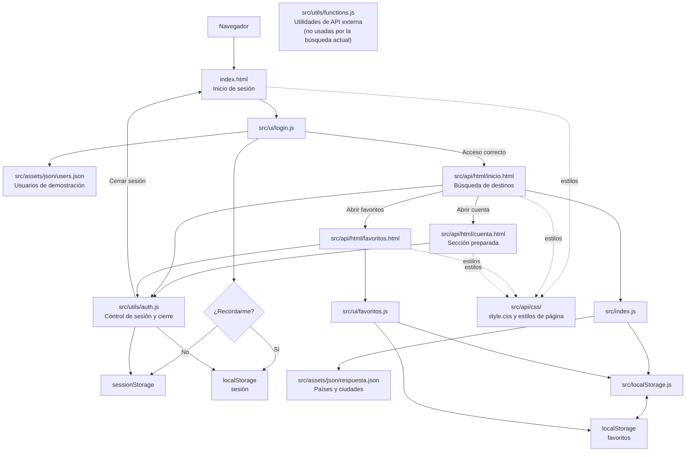

# Diagrama del proyecto

## Flujo de navegación y datos



## Estructura resumida

```text
AlmaViajera/
├── index.html                    # Acceso
├── docs/
│   ├── README.md                 # Descripción y ejecución
│   └── diagrama.md               # Este diagrama
└── src/
    ├── api/
    │   ├── html/                 # Inicio, cuenta, favoritos y prueba
    │   └── css/                  # Estilos compartidos y de página
    ├── assets/
    │   ├── i18n/                 # Textos disponibles
    │   ├── images/               # Imágenes y logo
    │   └── json/                 # Datos de destinos y usuarios demo
    ├── ui/                       # Interacciones de interfaz
    ├── utils/                    # Autenticación y utilidades
    ├── index.js                  # Búsqueda y tarjetas de destinos
    └── localStorage.js           # Favoritos del navegador
```